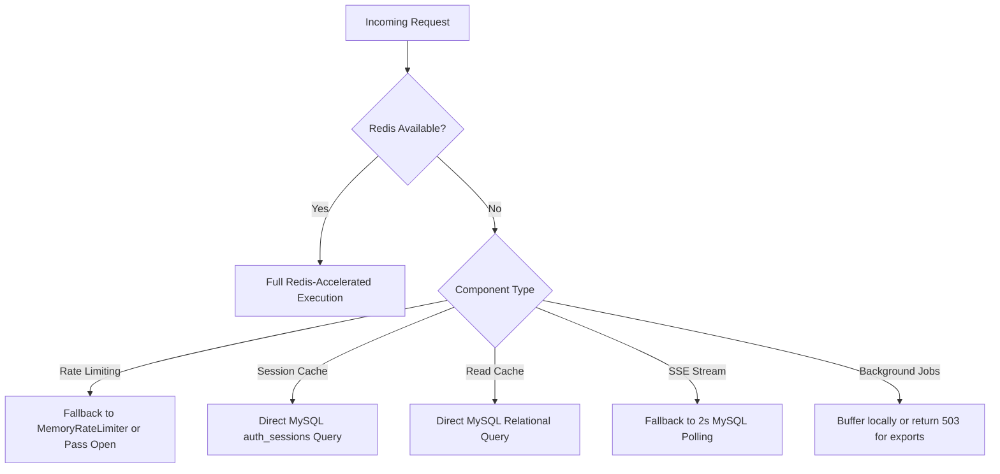

# Redis Infrastructure Architecture Audit: Avenx.js Community Platform

**Document Version:** 1.0.0  
**Target Architecture:** NestJS 11 / Express / MySQL 8.0 / Redis 7.x  
**Scope:** Performance, Scalability, Caching, Asynchronous Queuing, and Distributed Coordination  
**Status:** Architecture Recommendation / Engineering Specification  

---

## 1. Executive Summary

### 1.1 Assessment Overview

The **Avenx.js Community Platform** is a modular NestJS monolith exposing **189 API endpoints** across **40 controllers** and **12 feature modules**. Persistence is backed by MySQL 8.0 through a raw `mysql2/promise` connection pool configured with a strict ceiling of **10 concurrent connections** (`DatabaseModule`).

A comprehensive code-level audit of the controllers, service layers, interceptors, and database query pathways reveals that while the schema and indexing strategy are cleanly executed, the application suffers from severe architectural bottlenecks that prevent horizontal scaling and degrade performance under moderate concurrency:

1. **Catastrophic Rate Limiting I/O Amplification:** Every inbound request (outside of `GET /health`) passes through `ApiRateLimitInterceptor`. Each request evaluates 2 to 6 rate-limiting signals (`AuthRateLimitService.enforceApiRequest`). Crucially, every individual signal performs an atomic MySQL `INSERT ... ON DUPLICATE KEY UPDATE` followed immediately by a `SELECT ...` query on the `auth_rate_limits` table. A single content-creation write request executes up to 10 MySQL queries solely for rate-limit quota accounting before business logic begins. With a pool limit of 10 connections, fewer than 5 concurrent requests can completely saturate the database connection pool.
2. **Synchronous and Unmanaged Asynchronous Operations:**
   - **Outbound Email:** Password reset requests (`POST /auth/password/forgot`) execute an external SMTP dispatch (`await this.email.send(...)`) within the synchronous execution path of the request handler (`AuthService.forgotPassword`). Sluggish SMTP relays delay HTTP client responses. Conversely, email verification dispatches via detached fire-and-forget (`void this.email.send(...)`) without retries, job tracking, or persistence.
   - **Web Push Notifications:** The `PushDispatcherService` polls the database every 5 seconds (`PUSH_DISPATCH_INTERVAL_SECONDS`) using `FOR UPDATE OF n SKIP LOCKED`. It executes CPU-intensive cryptographic derivations (ECDH, HKDF, AES-128-GCM) and sequential HTTP push deliveries inside an event loop timer.
   - **Personal Data Exports:** Handled by `DataExportService.request()`, exports are queued via unmanaged Node.js `setImmediate()`. If 5 users simultaneously request an export, 5 unthrottled, unbounded scans across 12 relational tables execute in parallel without concurrency control or worker boundaries.
   - **Media Cleanup:** `MediaCleanupService` runs on an uncoordinated `setInterval` (default 300s) on each API instance, creating redundant, uncoordinated S3/local file deletion passes across multi-instance deployments.
3. **Real-Time Notification Polling:** The live notification stream (`GET /notifications/stream`) is implemented via Server-Sent Events (SSE). While SSE is architecturally superior to WebSockets for unidirectional server push, the current implementation (`NotificationStreamService`) executes an active polling loop against MySQL every 2,000 ms (`NOTIFICATION_STREAM_POLL_MS`) for all connected user IDs. Furthermore, session revocation and unread count events rely on an instance-local in-memory RxJS Subject (`SessionEvents`), rendering multi-instance clustering impossible without cross-node synchronization.
4. **Repeated Session Validation & Telemetry Overhead:** Every authenticated endpoint invokes `validateAccessTokenState`, which queries `auth_sessions JOIN users LEFT JOIN user_restrictions`. In addition, every authenticated request attempts an `UPDATE users SET last_seen_at = UTC_TIMESTAMP()` (throttled to 300-second windows). Under heavy read traffic, this produces massive redundant database churn.
5. **High-Cost Read Aggregations:** Endpoints such as `GET /communities/:name/stats` (executing 5 separate aggregation queries joining posts and comments), `GET /communities/trending`, `GET /communities/recommended` (joining peers, subscriptions, and subqueries over thousands of rows), and `/admin/analytics/*` (full table scans with `GROUP BY` and date truncation) perform repetitive calculations on data that changes slowly.

### 1.2 Introduction Recommendation: Staged Introduction

**Redis should be introduced into the Avenx.js Community Platform.** However, introduction must not be a blanket migration of application state. It must follow a strict, phased roadmap focused exclusively on addressing proven bottlenecks:

- **Immediate Introduction (High Value, Essential):**
  - Distributed Rate Limiting via atomic Redis operations (sliding window/token bucket via Lua scripts), completely removing rate-limiting queries from MySQL.
  - Background Job Processing via **BullMQ** for email delivery, Web Push dispatching, data export compilation, and scheduled media sweeps.
  - Session verification and restriction state caching with proactive invalidation.
- **Secondary Introduction (High Value, Scalability):**
  - Redis Pub/Sub for Server-Sent Events (SSE) notification broadcasting and cross-instance event propagation (`SessionEvents`, unread counts), eliminating the 2-second database polling loop.
  - Read-through caching for expensive community statistics, rule documents, discovery listings, and administrative analytics.
- **Explicit Exclusions (What Should NOT Use Redis):**
  - **No WebSockets:** The existing Server-Sent Events (SSE) model is optimal for the platform's unidirectional notification requirements. WebSockets should not be introduced.
  - **No GitHub Synchronization / Webhook Queues:** Neither feature exists in the current codebase. Speculative architectural expansion must be avoided.
  - **No Persistent State Relocation:** Primary entities (users, posts, comments, votes, restrictions, audit logs, reports) must remain in MySQL to guarantee ACID transactions, foreign key constraints, and relational consistency.
  - **No Full-Text Search in Redis:** Search must remain on MySQL FULLTEXT or transition to a dedicated engine (e.g., Meilisearch/Elasticsearch). Redis search modules (RediSearch) add unnecessary operational overhead for this stack.

---

## 2. Current Architecture & Bottleneck Analysis

### 2.1 Monolithic Structure & Persistence Model

The application follows the NestJS modular monolith pattern:

```
apps/api/src/
├── admin/          # Platform administration, analytics, audit logging, content moderation (40 endpoints)
├── auth/           # Registration, authentication, password reset, email verification, session lifecycle (13 endpoints)
├── comments/       # Hierarchical comment trees, moderation removals, subtree locking (14 endpoints)
├── common/         # Security headers, Swagger, ranking math, visibility predicates, rate-limit interceptor
├── communities/    # Community management, subscriptions, rules, flairs, bans, joins, transfers (40 endpoints)
├── database/       # DatabaseModule, raw mysql2 connection pool, custom SQL migration runner
├── email/          # EmailModule, SmtpEmailTransport (Nodemailer), LoggingEmailTransport
├── media/          # File uploads, Sharp processing, local/S3 media storage abstractions (10 endpoints)
├── notifications/  # Notification inbox, SSE streaming, Web Push (VAPID) crypto & dispatch (12 endpoints)
├── posts/          # Post creation, feeds, ranking, labels (NSFW/Spoiler), views, revisions (28 endpoints)
├── reports/        # User, post, comment, and community reporting workflows (4 endpoints)
├── search/         # Fulltext search across posts, comments, communities, and user prefix lookups (1 endpoint)
├── users/          # Public profiles, private account settings, user blocks, data exports (15 endpoints)
└── votes/          # Voting on posts and comments, Reddit-style hot/rising rank calculations
```

#### The Persistence Layer
- `DatabaseModule` (`apps/api/src/database/database.module.ts`) configures a single raw `mysql2/promise` pool with `connectionLimit: 10`, `waitForConnections: true`, and `queueLimit: 0`.
- The pool is injected across 25+ services via the `MYSQL_POOL` injection token.
- Migrations are sequentially executed from `data/migrations/*.sql` (`000_baseline.sql` through `042_add_community_ownership_transfer.sql`) via a lightweight custom runner (`apps/api/src/database/migrate.ts`).
- There is no ORM (no TypeORM, Prisma, or MikrORM). All queries are hand-crafted parameterized SQL statements. While this keeps queries transparent and fast, it creates high sensitivity to connection pool starvation when secondary concerns (like rate limiting and polling) compete for connections.

### 2.2 Deep Dive: Existing Bottlenecks

#### Bottleneck 1: Rate Limiting in MySQL (`AuthRateLimitService`)
Located in `apps/api/src/auth/auth-rate-limit.service.ts`:
- Invoked globally on all requests (except `GET /health`) via `ApiRateLimitInterceptor`.
- Every incoming request triggers `enforceApiRequest(ip, method, path, accountId)`.
- A typical authenticated write (e.g., `POST /posts`) generates 5 distinct signals:
  1. `api:request:ip` (window: 60s, limit: 300)
  2. `api:write:ip` (window: 60s, limit: 60)
  3. `api:write:account` (window: 60s, limit: 120)
  4. `api:content:create:ip` (window: 600s, limit: 10)
  5. `api:content:create:account` (window: 600s, limit: 5)
  6. `api:content:create:cooldown` (window: 30s, limit: 1)
- For **each signal**, `consume()` executes:
  ```sql
  INSERT INTO auth_rate_limits (bucket_key, window_started_at, request_count)
  VALUES (?, UTC_TIMESTAMP(), 1)
  ON DUPLICATE KEY UPDATE
    request_count = IF(window_started_at <= DATE_SUB(UTC_TIMESTAMP(), INTERVAL ? SECOND), 1, request_count + 1),
    window_started_at = IF(window_started_at <= DATE_SUB(UTC_TIMESTAMP(), INTERVAL ? SECOND), UTC_TIMESTAMP(), window_started_at)
  ```
  Followed immediately by:
  ```sql
  SELECT request_count, GREATEST(1, TIMESTAMPDIFF(SECOND, UTC_TIMESTAMP(), DATE_ADD(window_started_at, INTERVAL ? SECOND))) AS retry_after
  FROM auth_rate_limits WHERE bucket_key = ? LIMIT 1
  ```
- **Impact:** 12 round-trips to MySQL per post creation just to evaluate rate limits. Because the MySQL pool has only 10 connections, concurrent HTTP traffic easily leads to query queueing, thread starvation, and latency spikes across the entire API. Furthermore, table `auth_rate_limits` has no TTL or background reaper, accumulating rows indefinitely.

#### Bottleneck 2: SSE Real-Time Notification Polling (`NotificationStreamService`)
Located in `apps/api/src/notifications/notification-stream.service.ts`:
- Provides the real-time event stream via `GET /notifications/stream`.
- A timer fires every 2,000 ms (`NOTIFICATION_STREAM_POLL_MS`):
  ```typescript
  const [rows] = await this.pool.execute<RecentRow[]>(
    recentNotificationsSql(users.length),
    [...users, this.lookbackSeconds],
  );
  ```
- If any user received a notification, it calls `refreshUnread(userId)`, which runs `UNREAD_COUNT_SQL` (counting unread notifications with block-list exclusions).
- Additionally, every 15 seconds (`NOTIFICATION_STREAM_REVALIDATE_SECONDS`), it executes `liveStreamSessionsSql` across all active stream token hashes to verify session validity.
- **Impact:** With $N$ active connections on a single instance, polling scales linearly in query complexity and frequency. In a multi-instance deployment, each instance polls MySQL independently. A user connected to Instance A marking an inbox item as read does not trigger an `unread-count` event on Instance B because `NotificationInboxService.unreadChanged` is an in-memory RxJS `Subject` bounded to a single process.

#### Bottleneck 3: Background Jobs & External Integrations
- **Web Push (`PushDispatcherService`):** Every 5 seconds (`config.dispatchIntervalSeconds`), the dispatcher executes:
  ```sql
  SELECT ... FROM notifications n ... WHERE n.push_dispatched_at IS NULL
  ORDER BY n.created_at, n.id LIMIT ? FOR UPDATE OF n SKIP LOCKED
  ```
  It then performs synchronous elliptic-curve Diffie-Hellman, HKDF key derivation, and AES-128-GCM payload encryption (`encryptPushPayload` in `web-push-crypto.ts`) and delivers HTTP requests to push endpoints (FCM, Mozilla, Apple) sequentially within the event loop.
- **Personal Data Exports (`DataExportService`):** When `POST /users/me/export` is invoked, the service creates a record and triggers compilation using:
  ```typescript
  setImmediate(() => { void this.build(id, userId); });
  ```
  `build()` runs 12 comprehensive queries across user data, posts, comments, votes, subscriptions, community preferences, communities created, mod roles, saved posts, blocks, and reports filed. This runs unbounded in memory with no concurrency limit, no distributed queue, and no recovery if the server process restarts mid-build.
- **Password Reset Email (`AuthService.forgotPassword`):**
  ```typescript
  await this.email.send({ to: user.email, subject: '...', text: '...' });
  ```
  This is executed synchronously inside the HTTP handler. Any latency or timeout from the SMTP server directly stalls the client HTTP response.
- **Media Cleanup (`MediaCleanupService`):**
  Uses `setInterval` every 300 seconds to poll `RELEASE_STALE_UPLOADS_SQL` and `RELEASED_MEDIA_SQL` (batch of 100), deleting files from disk or S3. In a multi-replica setup, multiple instances run overlapping cleanup loops, generating redundant storage calls.

#### Bottleneck 4: Repetitive Session & Restriction Lookups (`AuthGuard`)
Located in `apps/api/src/auth/auth.service.ts` and `apps/api/src/auth/auth.guard.ts`:
- Every authenticated request calls `validateAccessTokenState(token)`.
- It executes:
  ```sql
  SELECT auth_sessions.user_id AS id,
         users.email_verified_at IS NOT NULL AS email_verified,
         restriction.type AS restriction_type,
         restriction.expires_at AS restriction_expires_at
  FROM auth_sessions
  JOIN users ON users.id = auth_sessions.user_id
  LEFT JOIN (
    SELECT user_id, type, expires_at FROM user_restrictions
    WHERE (type = 'ban' OR expires_at > UTC_TIMESTAMP())
  ) restriction ON restriction.user_id = auth_sessions.user_id
  WHERE auth_sessions.token_hash = ? AND auth_sessions.expires_at > UTC_TIMESTAMP()
  LIMIT 1
  ```
- Followed by an attempt to update telemetry:
  ```sql
  UPDATE users SET last_seen_at = UTC_TIMESTAMP()
  WHERE id = ? AND deleted_at IS NULL
    AND (last_seen_at IS NULL OR last_seen_at < DATE_SUB(UTC_TIMESTAMP(), INTERVAL ? SECOND))
  ```
- **Impact:** In an API serving hundreds of read requests per second (e.g., browsing feeds, viewing comments), this creates continuous read load and lock contention on `auth_sessions`, `users`, and `user_restrictions`.

---

## 3. Redis Use-Case Matrix

| Feature | Current Implementation | Redis Use Case | Affected Endpoints/Services | Priority | Recommendation |
|---|---|---|---|---|---|
| **API Rate Limiting** | MySQL `auth_rate_limits` table updated via `INSERT ... ON DUPLICATE KEY UPDATE` on every request. | In-memory atomic sliding window rate limiter via Redis Lua script + Sorted Set / Hash. | All endpoints via `ApiRateLimitInterceptor` & `AuthRateLimitService`. | **P1 (Critical)** | **Implement immediately.** Replaces MySQL rate limiting entirely, eliminating 2–10 SQL queries per API call. |
| **Outbound Email Delivery** | Synchronous `await email.send()` on password reset; unmanaged fire-and-forget on email verification. | BullMQ background job queue (`email-queue`) with exponential backoff and retry tracking. | `POST /auth/password/forgot`, `POST /auth/register`, `POST /auth/email/verify-request`, `PATCH /users/me/email`. | **P1 (Critical)** | **Implement immediately.** Offloads SMTP latency from HTTP request cycle; guarantees delivery retries. |
| **Personal Data Exports** | Unmanaged Node.js `setImmediate()` running 12 heavy SQL queries directly on the event loop. | BullMQ background job queue (`data-export-queue`) with concurrency throttling (max 1–2 jobs). | `POST /users/me/export`, `GET /users/me/export/{id}` (`DataExportService`). | **P1 (Critical)** | **Implement immediately.** Eliminates server crash vulnerability and unconstrained DB starvation. |
| **Live Notifications (SSE)** | `NotificationStreamService` polls MySQL every 2000 ms per active user; local RxJS event emitter. | Redis Pub/Sub: write paths publish notification events to user channels; SSE listeners stream to clients without polling. | `GET /notifications/stream`, `POST /notifications/stream-tickets`, all notification triggers. | **P2 (High)** | **Implement.** Eliminates MySQL 2-second polling loop and enables multi-instance API clustering. |
| **Web Push Dispatching** | 5-second polling loop with `FOR UPDATE SKIP LOCKED`; synchronous crypto and sequential HTTP calls. | BullMQ queue (`webpush-queue`) consumed by dedicated worker instances; jobs enqueued on notification creation. | `PushDispatcherService`, `PushSubscriptionsService`. | **P2 (High)** | **Implement.** Replaces DB polling with push-based job dispatch; parallelizes crypto and network I/O. |
| **Session & Restriction Verification** | SQL query on every authenticated request joining `auth_sessions`, `users`, and `user_restrictions`. | Cache token validation result (`userId`, `emailVerified`, `restriction`) with 300s TTL; evict on logout/ban. | `AuthGuard`, `OptionalAuthGuard`, `AuthService.validateAccessTokenState`. | **P2 (High)** | **Implement.** Reduces auth verification DB queries by >90% while preserving instantaneous revocation. |
| **Community Statistics** | 5 live aggregation SQL queries on every call, including joining `posts` and `comments`. | Cache aggregated DTO in Redis with 300s TTL; refresh on demand or via background job. | `GET /communities/{name}/stats` (`CommunityStatsService`). | **P3 (Medium)** | **Implement.** Offloads heavy aggregation queries without altering business logic. |
| **Community Rules & Versions** | SQL queries fetching published rule documents and items on community views and rule validations. | Cache active community rules DTO with 3600s TTL; invalidate immediately on `PUT .../rules`. | `GET /communities/{name}/rules`, `GET /communities/{name}/rules/versions` (`CommunityRulesService`). | **P3 (Medium)** | **Implement.** Community rules are highly static; caching prevents repeated join queries. |
| **Discovery & Recommendations** | Complex SQL joins across peer subscriptions and 7-day post activity unions. | Cache trending and recommended community results with 300s–600s TTL. | `GET /communities/trending`, `GET /communities/recommended` (`CommunityDiscoveryService`). | **P3 (Medium)** | **Implement.** Discovery feeds do not require real-time second-by-second precision. |
| **Admin Analytics Aggregations** | Multi-table date-range aggregations (`GROUP BY`, `COUNT`, `SUM`, `AVG`) across users, posts, reports. | Cache analytics responses keyed by date range and granularity with 300s TTL. | `GET /admin/analytics/*` (`AdminAnalyticsService`). | **P3 (Medium)** | **Implement.** Protects database from heavy analytics queries triggered by admin dashboards. |
| **Scheduled Media Cleanup** | In-process `setInterval` running every 300s across all running API instances. | BullMQ repeatable job (Cron: `*/5 * * * *`) with distributed lock to ensure single execution. | `MediaCleanupService`. | **P3 (Medium)** | **Implement.** Prevents duplicate sweeps across multi-instance deployments. |
| **Post & Comment Content Caching** | Direct SQL queries with complex viewer-specific visibility, NSFW, muting, and block predicates. | Do NOT cache personalized listings; cache individual raw post/comment entities if hot. | `GET /posts`, `GET /feed`, `GET /communities/{name}/posts`. | **P4 (Low)** | **Do not implement initially.** Cross-cutting block rules, mutes, and permissions make feed caching complex with high invalidation risk. |
| **Vote Counts & Hot Ranking** | Synchronous recalculation under row lock inside transaction (`RECOMPUTE_POST_RANKING_SQL`). | Keep ranking calculations in MySQL; read scores from MySQL; optionally cache score in Redis. | `VotesService`, `content-ranking.ts`. | **P4 (Low)** | **Retain in MySQL.** Ranks and scores are tied to transactional integrity and row locks. |
| **Full-Text Search** | MySQL `FULLTEXT` indices with `MATCH ... AGAINST (? IN BOOLEAN MODE)`. | None. | `GET /search` (`SearchService`). | **Reject** | **Do NOT use Redis.** RediSearch is an overcomplicated fit. If MySQL search is outgrown, migrate to Meilisearch or Elasticsearch. |
| **Persistent Security & Audit Data** | `users`, `auth_sessions`, `auth_refresh_tokens`, `password_reset_tokens`, `admin_actions`. | MySQL remains the source of truth; Redis only used for ephemeral caches and blacklists. | All auth and admin controllers. | **Reject** | **Do NOT move to Redis.** Security audit trails and credentials must remain durably persisted in MySQL. |
| **GitHub Integrations & Webhooks** | Not present in codebase. | None. | N/A | **Reject** | **Do NOT implement.** Non-existent feature; avoid speculative architecture. |

---

## 4. BullMQ Background Job Architecture

### 4.1 Justification for BullMQ
The current application attempts to handle background processing using primitive Node.js mechanisms (`setInterval`, `setImmediate`, unhandled promises). These patterns present significant architectural risks:
- **Process Crash / Restart Vulnerability:** When an instance restarts (e.g., rolling deployment), active `setImmediate` jobs (such as personal data exports) are abruptly terminated. In `DataExportService`, this leaves records in a `pending` state until timed out after 60 minutes.
- **Lack of Backoff and Retries:** Email sending via verification code does not retry on transient SMTP connection failures.
- **Thread & Connection Starvation:** Running heavy database scans or cryptographic Web Push operations directly within the API process degrades HTTP request throughput.

BullMQ (backed by Redis Streams and Lua scripts) provides persistent job storage, distributed concurrency control, retries with exponential backoff, dead-letter queues, and job deduplication.

### 4.2 Queue Topology & Job Specifications

```
                              ┌────────────────────────────────────────────────────────┐
                              │                   NestJS API Layer                     │
                              └───────┬─────────────────┬───────────────────┬──────────┘
                                      │                 │                   │
                            enqueue   │       enqueue   │         enqueue   │
                                      ▼                 ▼                   ▼
┌────────────────────────────────────────┐   ┌─────────────────────┐   ┌────────────────────────┐
│              BullMQ Queue              │   │    BullMQ Queue     │   │      BullMQ Queue      │
│             "email-queue"              │   │   "webpush-queue"   │   │  "data-export-queue"   │
└───────────────────┬────────────────────┘   └──────────┬──────────┘   └───────────┬────────────┘
                    │                                   │                          │
                    ▼                                   ▼                          ▼
┌────────────────────────────────────────┐   ┌─────────────────────┐   ┌────────────────────────┐
│              EmailWorker               │   │    WebPushWorker    │   │    DataExportWorker    │
│  - Concurrency: 10                     │   │  - Concurrency: 20  │   │  - Concurrency: 2      │
│  - Retries: 5 (exponential backoff)    │   │  - Retries: 3       │   │  - Retries: 1          │
│  - SmtpEmailTransport                  │   │  - ECDH / AES-GCM   │   │  - 12 DB Section Scans │
└────────────────────────────────────────┘   └─────────────────────┘   └────────────────────────┘
```

#### 1. `email-queue`
- **Purpose:** Reliable, non-blocking outbound email delivery (password resets, account verification codes, email change confirmation).
- **Enqueueing Service:**
  - `AuthService.forgotPassword()`: Enqueues password reset token delivery.
  - `EmailVerificationService.sendVerificationCode()`: Enqueues account confirmation.
  - `EmailVerificationService.requestEmailChange()`: Enqueues email change token.
- **Processing Worker:** `EmailWorker`
  - Injects `EmailTransport` (`SmtpEmailTransport` or `LoggingEmailTransport`).
  - Calls `transport.send(job.data)`.
- **Job Payload Schema:**
  ```typescript
  interface EmailJobPayload {
    to: string;
    subject: string;
    text: string;
    html?: string;
    category: 'password_reset' | 'email_verification' | 'email_change';
    userId: string;
  }
  ```
- **Concurrency:** 10 concurrent jobs per worker instance.
- **Retry Strategy:** 5 attempts with exponential backoff (`delay: 2000`, `backoff: { type: 'exponential', delay: 2000 }`).
- **Failure Handling:** On final exhaustion, logs critical error; writes failure event to operational logs. Does not reveal failure to public HTTP callers (preserving anti-enumeration guarantees).
- **Idempotency:** Enforce job deduplication key for password reset: `jobId = email:reset:${userId}:${tokenHash}`.

#### 2. `webpush-queue`
- **Purpose:** Decouple CPU-bound VAPID encryption and external HTTP dispatch from the application database.
- **Enqueueing Service:** `NotificationsService` / `NotificationInboxService` upon writing committed notifications to the database for accounts with registered push subscriptions.
- **Processing Worker:** `WebPushWorker`
  - Fetches active subscriptions for recipient from MySQL.
  - Computes ECDH shared secret, HKDF, and AES-128-GCM payload encryption.
  - Executes HTTP POST to push service endpoint.
- **Job Payload Schema:**
  ```typescript
  interface WebPushJobPayload {
    notificationId: string;
    recipientId: string;
    type: string;
    title: string;
    body: string;
    url?: string;
  }
  ```
- **Concurrency:** 25 concurrent jobs per worker instance.
- **Retry Strategy:** 3 attempts with exponential backoff (`delay: 1000`).
- **Failure Handling:**
  - HTTP 404 / 410 (Gone): Immediately execute `PUSH_GONE_SQL` (`DELETE FROM push_subscriptions WHERE id = ?`).
  - Network / 5xx errors: Increment failure counter; execute `PUSH_GIVE_UP_SQL` if threshold exceeded.
- **Idempotency:** `jobId = push:${notificationId}:${subscriptionId}`.

#### 3. `data-export-queue`
- **Purpose:** Controlled execution of heavy, multi-table personal data archive compilation (`GDPR / Data Portability`).
- **Enqueueing Service:** `DataExportService.request(userId)` replacing the unmanaged `setImmediate`.
- **Processing Worker:** `DataExportWorker`
  - Executes the 12 queries in `EXPORT_SECTIONS`.
  - Serializes JSON payload, computes size, and updates `data_exports` table (`status = 'ready'`).
- **Job Payload Schema:**
  ```typescript
  interface DataExportJobPayload {
    exportId: string;
    userId: string;
  }
  ```
- **Concurrency:** 1 to 2 concurrent jobs globally across workers to prevent relational database I/O saturation.
- **Retry Strategy:** 1 retry after 30 seconds.
- **Failure Handling:** On failure, updates MySQL record to `status = 'failed'`, enabling user to re-request after timeout.
- **Idempotency:** Enforced by MySQL unique constraint preventing multiple `pending` exports per user. `jobId = export:${exportId}`.

#### 4. `maintenance-queue` (Repeatable Jobs)
- **Purpose:** Centralized scheduling for background maintenance without instance-level duplication.
- **Scheduled Jobs:**
  1. `media-sweep`: Runs every 5 minutes. Calls `MediaCleanupService.run(100)` to remove unreferenced images/videos from storage.
  2. `data-export-sweep`: Runs every 10 minutes. Executes `EXPIRE_EXPORTS_SQL` and `FAIL_STALE_EXPORTS_SQL`.
  3. `stream-ticket-sweep`: Runs every 60 minutes. Executes `SWEEP_STREAM_TICKETS_SQL`.
- **Concurrency:** 1 (enforced by BullMQ repeatable job locks).
- **Failure Handling:** Log failure; retry on subsequent schedule interval.

---

## 5. Proposed Architecture & NestJS Integration

### 5.1 Infrastructure Topology Diagram

```mermaid
flowchart TD
    subgraph Client Tier
        Browser["Web Client / Mobile App"]
    end

    subgraph Edge & Proxy
        Nginx["Reverse Proxy (Nginx)"]
    end

    subgraph Application Tier (NestJS Monolith)
        API1["API Instance 1"]
        API2["API Instance 2"]
        Worker1["Dedicated Background Worker"]
    end

    subgraph Caching & Coordination Tier
        RedisPrimary["Redis 7.x Primary"]
        RedisReplica["Redis Replica (Optional)"]
    end

    subgraph Persistence Tier
        MySQL[(MySQL 8.0 Primary)]
        Storage[(Local / S3 Storage)]
    end

    Browser -->|HTTP REST / SSE Stream| Nginx
    Nginx -->|Load Balanced| API1
    Nginx -->|Load Balanced| API2

    API1 -->|Rate Limit / Cache / PubSub| RedisPrimary
    API2 -->|Rate Limit / Cache / PubSub| RedisPrimary
    Worker1 -->|BullMQ Queue Consumer| RedisPrimary

    API1 -->|Relational Queries| MySQL
    API2 -->|Relational Queries| MySQL
    Worker1 -->|Export / Maintenance Queries| MySQL
    Worker1 -->|Media File Cleanup| Storage

    RedisPrimary -.->|Async Replication| RedisReplica
```

### 5.2 Module Architecture

To adhere to clean architectural boundaries, Redis capabilities must be packaged in a dedicated, isolated infrastructure module: `RedisModule` (`apps/api/src/redis/`).

```
apps/api/src/redis/
├── redis.module.ts              # Global dynamic module providing Redis clients & tokens
├── redis-config.service.ts      # Validates environment configuration (REDIS_URL, pool sizes)
├── redis-connection.provider.ts # Factory creating standalone or cluster ioredis clients
├── redis-cache.service.ts       # Typed cache abstraction with TTL, tags, and getOrSet
├── redis-rate-limiter.service.ts# High-performance sliding window limiter using Lua scripts
├── redis-pubsub.service.ts      # Pub/Sub broker for SSE and distributed session events
├── redis-health.indicator.ts    # Terminus-compatible health check indicator
└── fallbacks/
    ├── memory-cache.service.ts  # In-memory LRU fallback when Redis is disabled
    └── memory-rate-limiter.ts   # In-memory sliding window fallback for local testing
```

### 5.3 Typed Service Abstractions

#### 1. Cache Abstraction (`RedisCacheService`)
```typescript
export interface CacheOptions {
  ttlSeconds: number;
  prefix?: string;
}

export abstract class CacheService {
  abstract get<T>(key: string): Promise<T | null>;
  abstract set<T>(key: string, value: T, options?: CacheOptions): Promise<void>;
  abstract del(key: string): Promise<void>;
  abstract delByPattern(pattern: string): Promise<void>;
  abstract getOrSet<T>(
    key: string,
    factory: () => Promise<T>,
    options?: CacheOptions,
  ): Promise<T>;
}
```

#### 2. Rate Limiting Abstraction (`RateLimiterStore`)
To ensure that `AuthRateLimitService` remains completely decoupled from Redis implementation details:
```typescript
export interface RateLimitResult {
  allowed: boolean;
  currentCount: number;
  remainingCount: number;
  retryAfterSeconds: number;
}

export abstract class RateLimiterStore {
  abstract incrementAndCheck(
    bucketKey: string,
    limit: number,
    windowSeconds: number,
  ): Promise<RateLimitResult>;
}
```

### 5.4 Lifecycle Management & Resilience

- **Connection Lifecycle:** The Redis connection must be managed via NestJS `OnApplicationBootstrap` and `OnApplicationShutdown`.
- **Graceful Shutdown:** On SIGTERM/SIGINT:
  1. Stop accepting new BullMQ jobs.
  2. Allow in-flight jobs 10 seconds to finish (`worker.close()`).
  3. Close Redis Pub/Sub listeners.
  4. Disconnect Redis client pool (`redis.quit()`).
- **Connection Failure & Offline Queueing:** `ioredis` must be configured with `enableOfflineQueue: false` for rate limiting and caching. If Redis is down, calls fail fast rather than hanging the HTTP event loop.
- **Degraded Operation Mode (`REDIS_ENABLED`):**
  - When `REDIS_ENABLED=false` (e.g. lightweight local dev, initial unit testing):
    - `RateLimiterStore` binds to `MemoryRateLimiterStore`.
    - `CacheService` binds to `MemoryCacheService` (LRU in memory).
    - `BullMQ` degrades to in-process synchronous dispatch or in-memory execution.
    - SSE notification stream falls back to the existing 2-second database polling mechanism.

---

## 6. Redis Data Design & Key Topology

### 6.1 Naming Conventions & Namespaces

All keys must follow the standard namespace convention:
`avenx:{environment}:{module}:{subsystem}:{identifier}`

Default production prefix: `avenx:prod:`

### 6.2 Key Specifications Table

| Key Pattern | Data Structure | TTL | Invalidation Trigger | Purpose / Content |
|---|---|---|---|---|
| `avenx:rl:{scope}:{hash}` | Hash or Sorted Set | `windowSeconds + 5s` | Automatic (TTL) | Sliding window rate limit counters. |
| `avenx:session:{tokenHash}` | String (JSON) | 300s (5 min) | Explicit on logout, session revoke, user ban/suspend | Cached validation state: `{ userId, emailVerified, role, restriction }`. |
| `avenx:cache:comm:rules:{name}` | String (JSON) | 3600s (1 hour) | Explicit on `PUT .../rules` | Published community rules document and rule items. |
| `avenx:cache:comm:stats:{name}` | String (JSON) | 300s (5 min) | Automatic (TTL) | Aggregated member, moderator, post, and comment counts. |
| `avenx:cache:comm:trending` | String (JSON) | 600s (10 min) | Automatic (TTL) | Discovery list of trending communities. |
| `avenx:cache:comm:rec:{userId}` | String (JSON) | 600s (10 min) | Automatic (TTL) | Peer-based community recommendations for user. |
| `avenx:cache:analytics:{metric}:{hash}`| String (JSON) | 300s (5 min) | Automatic (TTL) | Heavy aggregation results for admin analytics queries. |
| `avenx:channel:user:{userId}` | Pub/Sub Channel | Ephemeral (N/A) | Real-time broadcast | Notification payload broadcast for live SSE streams. |
| `avenx:channel:system:events` | Pub/Sub Channel | Ephemeral (N/A) | Real-time broadcast | Cluster-wide broadcast for session revocation & bans. |
| `bull:email-queue:*` | Redis Stream / ZSET | Managed by BullMQ | On job completion / retention policy | BullMQ queue state for outbound emails. |
| `bull:webpush-queue:*` | Redis Stream / ZSET | Managed by BullMQ | On job completion / retention policy | BullMQ queue state for Web Push deliveries. |
| `bull:data-export-queue:*` | Redis Stream / ZSET | Managed by BullMQ | On job completion / retention policy | BullMQ queue state for data export jobs. |

### 6.3 Rate Limiting Lua Script (Sliding Window Algorithm)

To replace the expensive MySQL `INSERT ... ON DUPLICATE KEY UPDATE` and `SELECT`, execute an atomic Redis Lua script using a sliding log or sliding window counter:

```lua
-- KEYS[1]: Rate limit bucket key (e.g. avenx:rl:api:write:ip:hash)
-- ARGV[1]: Current UTC timestamp in milliseconds
-- ARGV[2]: Window size in milliseconds
-- ARGV[3]: Maximum request limit

local key = KEYS[1]
local now = tonumber(ARGV[1])
local window = tonumber(ARGV[2])
local limit = tonumber(ARGV[3])
local clearBefore = now - window

-- Remove entries outside the current window
redis.call('ZREMRANGEBYSCORE', key, 0, clearBefore)

-- Count entries in current window
local currentRequests = redis.call('ZCARD', key)

if currentRequests < limit then
    -- Add current request token
    redis.call('ZADD', key, now, now)
    redis.call('PEXPIRE', key, window)
    return { 1, limit - currentRequests - 1, 0 } -- allowed, remaining, retryAfter
else
    -- Fetch oldest entry in window to calculate retryAfter
    local oldest = redis.call('ZRANGE', key, 0, 0, 'WITHSCORES')
    local retryAfterMs = (tonumber(oldest[2]) + window) - now
    local retryAfterSeconds = math.ceil(retryAfterMs / 1000)
    if retryAfterSeconds < 1 then retryAfterSeconds = 1 end
    return { 0, 0, retryAfterSeconds } -- blocked, remaining, retryAfter
end
```
**Benefits:**
- Exactly 1 network round-trip from NestJS to Redis.
- Zero disk I/O; 100% in-memory execution in <0.5ms.
- Completely frees MySQL connection pool from rate-limiting traffic.
- Automatic key eviction via `PEXPIRE`.

---

## 7. Failure Handling & Resilience Strategy

A primary rule of the architecture audit is: **The platform must not become fragile or completely non-functional if Redis experiences downtime.**

### 7.1 Tiered Degradation Matrix



### 7.2 Component-Specific Resilience Rules

#### 1. Rate Limiting During Redis Outage
- **Configuration Option:** `RATE_LIMIT_ON_REDIS_ERROR = 'memory' | 'pass_open' | 'fail_closed'`.
- **Default (Recommended):** `'memory'`
  - Fall back to an in-memory sliding window limiter (`MemoryRateLimiterStore`) per API instance.
  - This protects the underlying MySQL database from sudden unconstrained DDoS while avoiding false 500 errors to legitimate users.
  - Crucially: **Do NOT fall back to MySQL `auth_rate_limits` during Redis outage**, because hitting MySQL for rate limits during an infrastructure incident will cascade the failure into total database pool exhaustion.

#### 2. Session Validation During Redis Outage
- When `avenx:session:{tokenHash}` fails or Redis is unreachable:
  - Immediately pass through to the primary MySQL query:
    `SELECT ... FROM auth_sessions JOIN users ...`
  - Wrap the Redis call in a circuit breaker (`opossum` or simple rolling error counter). If Redis is unreachable, skip cache lookups for 15 seconds to eliminate connection timeout delays.

#### 3. Live Notification Streams (SSE) During Redis Outage
- If Redis Pub/Sub connectivity is lost:
  - Keep client SSE connections open.
  - Automatically fall back `NotificationStreamService` to its legacy 2,000 ms database polling loop until Redis connectivity is restored.
  - Upon reconnection, re-subscribe to Redis channels and suspend database polling.

#### 4. BullMQ Queues During Redis Outage
- If Redis is unreachable when enqueuing:
  - **Email:** For synchronous user actions (e.g., password forgot), if queue enqueue fails, attempt direct emergency dispatch via `EmailTransport` as a fallback, or return an operational error.
  - **Data Export:** Return `503 Service Unavailable` with message `"Export preparation temporarily unavailable; please try again later"`.
  - **Web Push:** Drop or buffer in-memory; notification is already committed in MySQL and visible in user inbox.

---

## 8. Security Architecture & Sensitive Data

### 8.1 Network & Access Control
1. **Network Binding:** Redis must strictly bind to `127.0.0.1` (or private Docker container network `community_default`). Port `6379` must **never** be exposed on the public host interface or mapped publicly in `docker-compose.yml`.
2. **Authentication:** Require strong Redis authentication via `requirepass` or Redis 6+ ACLs:
   ```conf
   user default off
   user avenx_api on >StrongGeneratedPassword ~avenx:* &* +@all -@dangerous
   ```
   Disable dangerous administrative commands (`FLUSHALL`, `FLUSHDB`, `KEYS`, `CONFIG`, `SHUTDOWN`) in production Redis configuration:
   ```conf
   rename-command FLUSHALL ""
   rename-command FLUSHDB ""
   rename-command CONFIG ""
   rename-command KEYS ""
   ```
3. **Transport Encryption:** Support TLS (`rediss://`) via `REDIS_TLS=true` for managed cloud Redis providers (e.g., AWS ElastiCache, Upstash, Google Cloud Memorystore).

### 8.2 Sensitive Data Handling

- **Raw Tokens Never Stored in Plaintext:**
  - In strict alignment with existing platform conventions (`hashOpaqueToken` using SHA-256), raw Bearer access tokens, refresh tokens, and stream tickets must **never** be used as Redis keys or stored in values.
  - Redis session keys must store only the SHA-256 hash: `avenx:session:${sha256(token)}`.
- **Password Hashes & Reset Secrets:**
  - Password hashes (Argon2id) must **never** be cached in Redis.
  - Verification tokens and password reset tokens must remain in MySQL `password_reset_tokens` to ensure strict single-use consumption under MySQL row locks (`SELECT ... FOR UPDATE`).
- **Privacy & PII in Rate Limiting:**
  - The existing platform hashes rate-limit signals using HMAC-SHA256 (`hashSignal` in `auth-rate-limit.service.ts`). This practice must be preserved in Redis: keys will contain `avenx:rl:{scope}:${hmac(scope, value)}`. Raw client IP addresses and usernames will never appear as plaintext keys in Redis.

---

## 9. Local-First & Self-Hosting Considerations

The Avenx.js Community Platform is designed to be easily self-hosted. Adding complex infrastructure dependencies could undermine this design goal.

### 9.1 Self-Hosting Principle: Redis as an Opt-In Accelerator

1. **Docker Compose Integration:**
   Add a lightweight Redis service to `docker-compose.yml`:
   ```yaml
   redis:
     image: redis:7.2-alpine
     container_name: community_redis
     restart: always
     command: redis-server --save 60 1 --loglevel warning --requirepass ${REDIS_PASSWORD}
     volumes:
       - redis_data:/data
     # Port 6379 is NOT published to host; internal Docker network only
     healthcheck:
       test: ["CMD", "redis-cli", "-a", "${REDIS_PASSWORD}", "ping"]
       interval: 10s
       timeout: 5s
       retries: 5

   volumes:
     db_data:
     redis_data:
   ```
2. **Resource Footprint:**
   - A base `redis:7.2-alpine` container consumes less than **25 MB RAM** on startup.
   - Configure a strict memory cap to prevent out-of-memory errors on small $5/month VPS instances:
     ```conf
     maxmemory 128mb
     maxmemory-policy volatile-lru
     ```
   - With `volatile-lru`, volatile cache keys are evicted when memory reaches 128 MB, while persistent BullMQ queue keys (without TTLs) are protected.
3. **Persistence Configuration:**
   - For a community platform, Redis is primarily used for ephemeral caches and short-lived queues.
   - Use lightweight RDB snapshots (`save 900 1` or `save 60 1`) rather than high-IOPS Append-Only Files (AOF), minimizing disk write amplification on budget SSDs.
4. **Standalone Local Development:**
   - When developers run `npm run start:dev` without Docker, `REDIS_ENABLED` defaults to `false`.
   - The application automatically activates in-memory fallbacks, allowing local frontend and backend work without running a Redis daemon.

---

## 10. Performance & Scalability Impact Analysis

| Architectural Change | Current State (Measured / Code Reality) | Target State with Redis | Expected Performance Benefit | Consistency / Failure Risk |
|---|---|---|---|---|
| **API Rate Limiting** | 2–10 MySQL queries per request (`auth_rate_limits`). Connection pool limit = 10. | 1 atomic Redis Lua call (<0.5ms). Zero MySQL queries. | **>80% reduction** in MySQL connection pool contention. Prevents DB lockouts during traffic spikes. | Negligible. Ephemeral rate limit data; fallback to memory limiter. |
| **Session Verification** | 1 multi-table join query (`auth_sessions`, `users`, `restrictions`) on every authenticated call. | Redis `GET avenx:session:{hash}` (1ms). MySQL accessed only on cache miss. | **>90% reduction** in auth-related SQL queries for active sessions. | Low. Proactive cache eviction on logout/ban maintains instant revocation. |
| **Live Notifications (SSE)** | MySQL polled every 2000ms for all connected accounts. In-memory RxJS event emitter. | Event-driven Redis Pub/Sub push. Zero polling queries. | Eliminates **30 queries/minute per connected user** against MySQL. Enables horizontal scaling. | Low. Redis Pub/Sub messages are at-most-once; client reconnects sync via inbox API. |
| **Email Delivery** | Synchronous SMTP dispatch on password reset blocking HTTP response. | BullMQ background queue with async worker. | HTTP response time drops from **1,500ms–3,000ms to <50ms** for forgot-password. | None. Improves delivery reliability through retries. |
| **Personal Data Export** | Unbounded `setImmediate` running 12 heavy relational scans concurrently. | BullMQ queue with `concurrency: 1`. | Eliminates sudden CPU/memory exhaustion on database. | None. Predictable, scheduled batch execution. |
| **Web Push Notifications** | 5s polling loop with `FOR UPDATE SKIP LOCKED` + synchronous ECDH crypto. | BullMQ job triggered on notification creation. | Eliminates polling queries; parallelizes crypto operations outside request loop. | None. Web push is inherently asynchronous. |
| **Community Stats & Rules** | 5 live aggregation joins per stats request; repeated rule document joins. | Read-through cache with 300s/3600s TTL. | Sub-millisecond response times for community sidebar widgets. | Negligible. Stats tolerate 5-minute eventual consistency; rules evict on write. |

---

## 11. Phased Implementation Roadmap

### Phase 1: Essential Infrastructure & Rate Limiting
- **Goal:** Eliminate database pool starvation caused by rate limiting; establish resilient Redis connectivity.
- **Scope:**
  - Create `apps/api/src/redis/` module.
  - Implement `RedisConfigService` reading `REDIS_ENABLED`, `REDIS_HOST`, `REDIS_PORT`, `REDIS_PASSWORD`.
  - Implement `RedisConnectionProvider` using `ioredis` with automatic reconnection and error handling.
  - Implement `RedisRateLimiterService` using atomic Lua script.
  - Refactor `AuthRateLimitService` to delegate quota consumption to `RedisRateLimiterService`, with automatic fallback to in-memory store if Redis is unavailable.
  - Add Redis container to `docker-compose.yml` and configuration keys to `sample.env`.
- **Dependencies:** None.
- **Testing Requirements:**
  - Unit tests verifying sliding window rate-limit accuracy and boundary conditions.
  - Fault tolerance tests verifying seamless degradation when Redis connection is severed.
  - E2E test verifying `ApiRateLimitInterceptor` returns `429 Too Many Requests` with identical `Retry-After` headers.

### Phase 2: High-Value Caching
- **Goal:** Offload read pressure from MySQL for session verification, static community rules, and heavy aggregations.
- **Scope:**
  - Implement `RedisCacheService` with typed `getOrSet`, TTL, and pattern-based deletion.
  - Cache session validation results in `AuthService.validateAccessTokenState()` (TTL: 300s).
  - Add cache invalidation hooks in `AuthService.logout()`, `revokeSession()`, `logoutAll()`, and `AdminRestrictionsService.create()`.
  - Cache community rules (`CommunityRulesService.getRules()`, TTL: 3600s), invalidating on `publish()`.
  - Cache community statistics (`CommunityStatsService.get()`, TTL: 300s).
  - Cache trending and recommended communities (`CommunityDiscoveryService`, TTL: 600s).
  - Cache admin analytics metrics (`AdminAnalyticsService`, TTL: 300s).
- **Dependencies:** Phase 1 (`RedisModule`).
- **Testing Requirements:**
  - Verify cache hits return byte-for-byte identical DTO responses.
  - Verify immediate cache invalidation when a session is revoked or rules are updated.
  - Verify cache misses seamlessly query MySQL without error.

### Phase 3: Background Processing with BullMQ
- **Goal:** Eliminate synchronous SMTP blocking and unmanaged background tasks.
- **Scope:**
  - Introduce `BullMQModule` configured with Redis connection.
  - Implement `email-queue` and `EmailWorker`. Refactor `AuthService.forgotPassword()` and `EmailVerificationService` to enqueue email jobs.
  - Implement `data-export-queue` and `DataExportWorker`. Refactor `DataExportService.request()` to enqueue export tasks with strict concurrency limit (`concurrency: 1`).
  - Implement `webpush-queue` and `WebPushWorker`. Refactor `NotificationsService` to enqueue push tasks instead of polling with `SKIP LOCKED`.
  - Implement `maintenance-queue` with BullMQ repeatable jobs to manage `media-sweep` and export cleanup sweeps.
- **Dependencies:** Phase 1 (`RedisModule`).
- **Testing Requirements:**
  - Integration tests for job retries on simulated SMTP/Push failure.
  - Verify dead-letter handling after 5 failed attempts.
  - Verify data exports execute serially without exceeding MySQL connection limits.

### Phase 4: Distributed SSE & Cluster-Ready Coordination
- **Goal:** Enable multi-instance horizontal scaling for real-time notifications.
- **Scope:**
  - Implement `RedisPubSubService` providing managed publisher and subscriber clients.
  - Refactor `NotificationStreamService`:
    - Eliminate 2,000 ms MySQL polling loop.
    - Subscribe instances to `avenx:channel:user:{userId}` on connection.
    - Publish notification events to the channel upon creation in `NotificationsService`.
  - Replace in-process `SessionEvents` RxJS Subject with cluster-wide Redis Pub/Sub channel (`avenx:channel:system:events`), ensuring immediate stream closure across all backend instances when a session is revoked or a user is suspended.
- **Dependencies:** Phase 1 (`RedisModule`) and Phase 2 (`Session Caching`).
- **Testing Requirements:**
  - Multi-instance integration test: Connect SSE client to Instance 1; trigger notification on Instance 2; verify event is delivered in <50ms.
  - Multi-instance session termination test: Revoke session on Instance 1; verify SSE stream on Instance 2 terminates immediately.

---

## 12. Final Recommendation Summary

### 1. Implement Immediately (Phase 1 & Phase 3 Core)
- **Redis-Backed Rate Limiting:** The single most urgent requirement. Running rate-limiting queries through MySQL's 10-connection pool is the platform's primary scalability bottleneck.
- **BullMQ for Email & Data Exports:** Critical for operational reliability, user experience, and server stability.

### 2. Implement Next (Phase 2 & Phase 4)
- **Session & Restriction State Caching:** High performance return with very low implementation complexity.
- **Redis Pub/Sub for SSE Live Notifications:** Essential prior to deploying more than one backend API instance.
- **Community Statistics & Discovery Caching:** Substantially speeds up community browsing and exploration.

### 3. What Should NOT Use Redis
- **Do NOT implement WebSockets:** The existing Server-Sent Events architecture is cleaner, simpler, and completely sufficient for the platform's unidirectional push requirements.
- **Do NOT migrate persistent storage:** Relational data, user accounts, posts, comments, votes, moderation actions, and audit logs must remain in MySQL.
- **Do NOT build GitHub / Webhook Queues:** Neither capability exists in the codebase.
- **Do NOT use Redis for Full-Text Search:** Keep MySQL FULLTEXT indexing.

### 4. Is BullMQ Justified?
**Yes, unequivocally.** The application is already running four distinct asynchronous workflows (email, push notifications, data export generation, and media cleanup sweeps). Implementing these via ad-hoc Node.js primitives (`setImmediate`, `setInterval`) introduces memory leak vulnerabilities, crash recovery gaps, and connection pool starvation. BullMQ provides the robust queue guarantees required for production.

### 5. Mandatory vs. Optional Redis
- **For Production Deployments:** **Mandatory.** Running a 189-endpoint platform in production without a dedicated caching and queuing layer results in poor database utilization and vulnerability to traffic spikes.
- **For Local Development & Self-Hosters:** **Optional.** The application architecture must support `REDIS_ENABLED=false` using the provided in-memory fallbacks, preserving the platform's ease of deployment and low barrier to entry.
